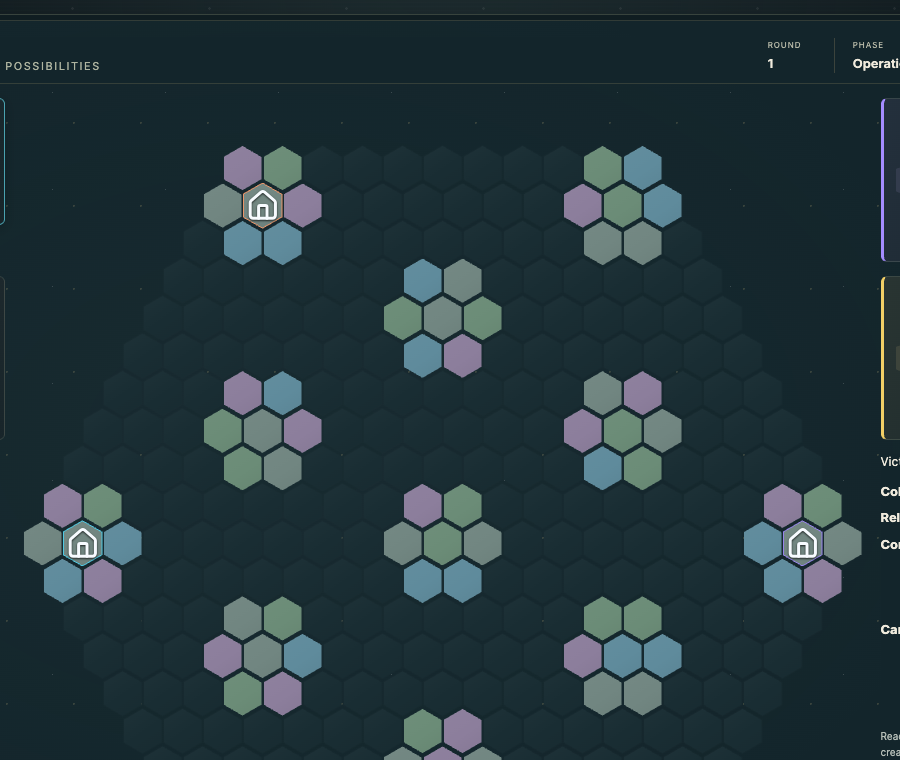
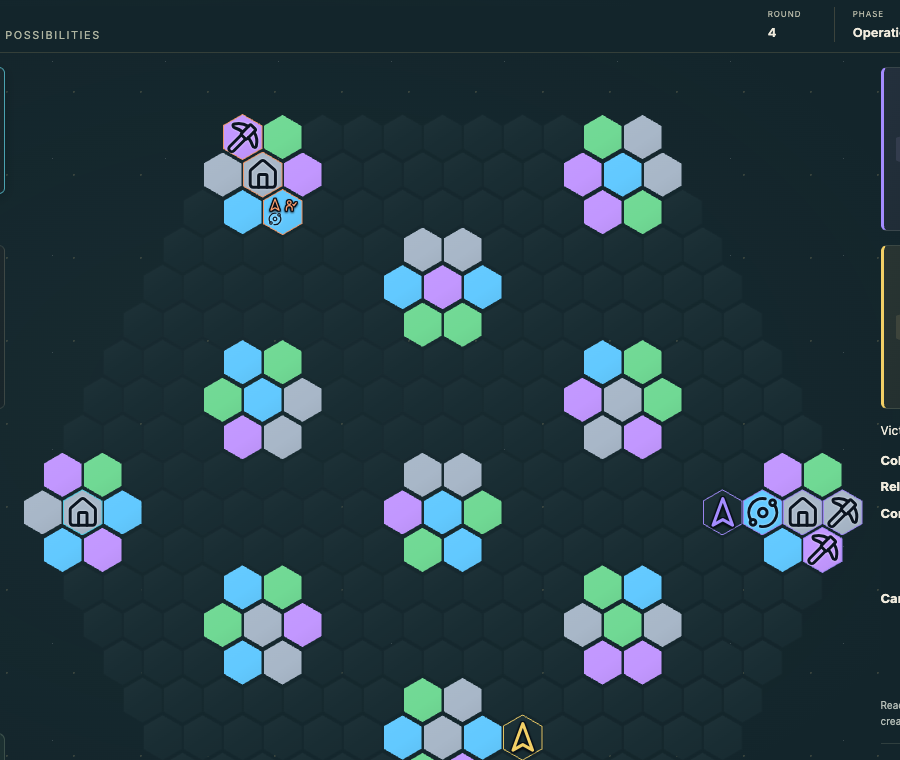

# Cheaper Cards (32.37 playtest)

**Request.** After playing 31.36 the captain asked (2026-11-14): "Update the current costs on the new cards cheaper and increase the harvester to 2 production." Firstmate added the decided reading of issue #41 and the captain's map-colour request to the same playtest.

**Rule** ([#capacity-cards](../../prototypes/galactic-reach/rulebook.html#capacity-cards), [#cards](../../prototypes/galactic-reach/rulebook.html#cards), [#resources](../../prototypes/galactic-reach/rulebook.html#resources), [#building](../../prototypes/galactic-reach/rulebook.html#building), [#setup](../../prototypes/galactic-reach/rulebook.html#setup)):

- **Capacity Cards about 30% cheaper.** The 36-card set costs 266 resources in total, down from 376 (29% less). Each card's largest cost falls by about 30%, but never below 5. Smaller costs fall by about 40%. The six 5 + 1 cards drop their 1. Every card still costs more than the starting limit of 4 in at least one resource, so capacity growth is still required. The cheapest cards cost exactly 5 of one resource, one capacity upgrade away; the top cards cost 14. Card effects, ids, copies and the market are unchanged.
- **Harvester produces 2.** Through 31.36 a Harvester hex produced **1** of its resource, the same as any owned planet hex. In 32.37 it produces **2** (`HARVESTER_YIELD`).
- **Issue #41 (decided costs reading).** A Settler costs 1 Matter, 1 Energy and **1 Biomass** (was 1 Matter, 1 Energy). A Harvester costs 1 Matter, 1 Energy and **1 Data** (was 1 Matter, 1 Energy, 1 Biomass). Every faction starts with **1 Biomass and 1 Data** (was 2 Biomass), so it opens with 1 Matter, 1 Biomass and 1 Data after round-1 Colony production. #41's "production is unchanged" is superseded by the Harvester change above.
- **Brighter map (interface only).** Terrain hexes use the legend swatches' full colours (`--matter`, `--energy`, `--biomass`, `--data`) instead of muted mixes. Building icons switch to dark ink on them, and fleet icons keep their dark outline. This is also applied to the archived 31.36 stylesheet (its hash is re-pinned), so 31.36 tables get the same map. Older archives keep their colours.

  | Before (31.36 muted terrain) | After (legend colours, round 4 with units) |
  | --- | --- |
  |  |  |

| Id | Card | 31.36 cost | 32.37 cost | Total |
| --- | --- | --- | --- | --- |
| N01 | Ion Thrusters | 5E 1D | 5E | 6 → 5 (17% less) |
| N02 | Slipstream Charts | 1E 5D | 5D | 6 → 5 (17% less) |
| N03 | Strike Vector | 2M 6E | 1M 5E | 8 → 6 (25% less) |
| N04 | Fold-Space Gate | 10E 4D | 7E 2D | 14 → 9 (36% less) |
| N05 | Prefab Yards | 5M 1E | 5M | 6 → 5 (17% less) |
| N06 | Orbital Foundry | 7M 2E 1D | 5M 1E 1D | 10 → 7 (30% less) |
| N07 | World Engine | 10M 3E 3B | 7M 2E 2B | 16 → 11 (31% less) |
| N08 | Seed Ark | 1M 5B | 5B | 6 → 5 (17% less) |
| N09 | Colony Pods | 2E 7B | 1E 5B | 9 → 6 (33% less) |
| N10 | Genesis Charter | 4M 11B 2D | 2M 8B 1D | 17 → 11 (35% less) |
| N11 | Mining Charter | 5M 1D | 5M | 6 → 5 (17% less) |
| N12 | Bio-Reactor | 2E 5B | 1E 5B | 7 → 6 (14% less) |
| N13 | Data Haven | 1E 6D | 1E 5D | 7 → 6 (14% less) |
| N14 | Harvest Cycle | 3M 6B | 2M 5B | 9 → 7 (22% less) |
| N15 | Quartermaster | 2M 5E 1B | 1M 5E 1B | 8 → 7 (12% less) |
| N16 | Strategy Core | 2E 6D | 1E 5D | 8 → 6 (25% less) |
| N17 | Archive Purge | 2B 5D | 1B 5D | 7 → 6 (14% less) |
| N18 | Command Nexus | 4E 9D | 2E 6D | 13 → 8 (38% less) |
| N19 | Cargo Expansion | 6M 2D | 5M 1D | 8 → 6 (25% less) |
| N20 | Hyperspace Vaults | 4M 2E 9D | 2M 1E 6D | 15 → 9 (40% less) |
| N21 | Procurement Hub | 2B 6D | 1B 5D | 8 → 6 (25% less) |
| N22 | Trade Syndicate | 5E 2D | 5E 1D | 7 → 6 (14% less) |
| N23 | Monument of Accord | 8M 4B 3D | 6M 2B 2D | 15 → 10 (33% less) |
| N24 | Galactic Senate Seat | 5E 2B 9D | 3E 1B 6D | 16 → 10 (38% less) |
| N25 | Dyson Lattice | 6M 12E 4D | 4M 8E 2D | 22 → 14 (36% less) |
| N26 | Ascendancy Codex | 3E 6B 12D | 2E 4B 8D | 21 → 14 (33% less) |
| M01 | Rail Battery | 5M 1E | 5M | 6 → 5 (17% less) |
| M02 | Deflector Grid | 1M 5E | 5E | 6 → 5 (17% less) |
| M03 | Flak Screen | 6M 2B | 5M 1B | 8 → 6 (25% less) |
| M04 | Boarding Marines | 2M 6B | 1M 5B | 8 → 6 (25% less) |
| M05 | Torpedo Spread | 7E 2D | 5E 1D | 9 → 6 (33% less) |
| M06 | Hardlight Bulwark | 7M 2E | 5M 1E | 9 → 6 (33% less) |
| M07 | Phase Lance | 8E 3D | 6E 2D | 11 → 8 (27% less) |
| M08 | Nova Barrage | 5M 10E | 3M 7E | 15 → 10 (33% less) |
| M09 | Aegis Lattice | 10M 4E | 7M 2E | 14 → 9 (36% less) |
| M10 | Victory Doctrine | 2M 4E 9D | 1M 2E 6D | 15 → 9 (40% less) |

**Rivals.** Browser rivals value cards from the card definitions, so they read the new prices directly. Their reserve for the next scoring unit now includes the Settler's Biomass. The native server rivals (policy 26, used at shared tables and in the arena) read prices from the observation (`marketCosts`) and Harvester output from `harvesterYield`. Without those fields (31.36 archives) they fall back to the 31.36 card table and 1 per Harvester, so archived games play exactly as before. The policy version is unchanged.

**Shared tables keep their rules.** `galactic_reach::SHARED_RULES` lists the current rules and the archived 31.36 engine. `GalacticReach::shared` boots the table's own rules, so a 31.36 shared table keeps playing after this cutover. (PR #47 is separately pinning shared tables to their revision; the two changes overlap here.)

**Versioning.** `playtest-breaking`: card costs, production, unit and structure costs, and setup change.

- New games use **save 32, rules 37** (`galactic-reach/32.37`, "Cheaper Cards playtest").
- The exact 31.36 browser, manual, engine and shared-table page are archived as `crates/galactic-reach/rules/v31-*`. The only deliberate edit is the brighter terrain in `v31-styles.css`. They are served at `/galactic-reach/rules/31.36/` and pinned in `scripts/cheaper-cards-archive-hashes.json`.
- 31.36 tables, replays, `with_rules` and shared tables use that archive.

**Balance (12 seeded four-rival games to 40, before → after).** All 12 games finished in both runs.

| | 31.36 | 32.37 |
| --- | --- | --- |
| Rounds to 40 (mean, range) | 41.5 (31–55) | 32.4 (24–43) |
| Cards bought per player | 13.9 | 15.5 |
| Capacity upgrades per player | 4.5 | 3.7 |
| Colonies per player | 3.2 | 3.2 |
| Winner's card Prestige | 18.8 | 23.6 |
| Wins: Military / Economy / Expansion | 1 / 5 / 6 | 4 / 5 / 3 |

Cheaper cards and 2-yield Harvesters shorten the game by about 9 rounds. Rivals still raise capacity on every path. The Military profile wins more often, which is plausibly the cheaper military cards. This is a smoke sample, not a balance study.
